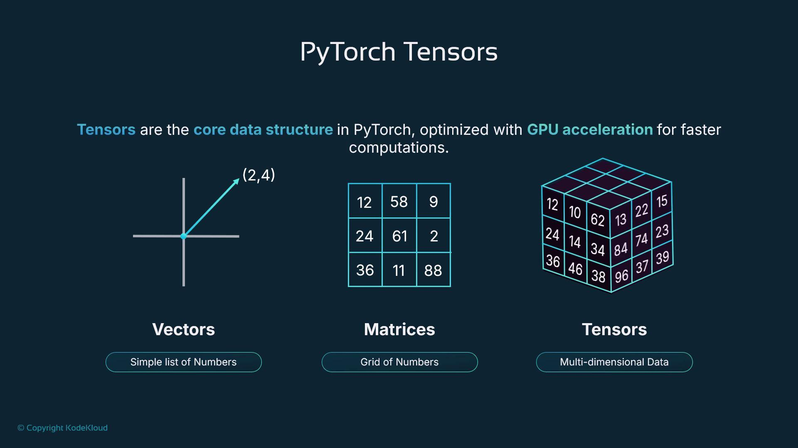
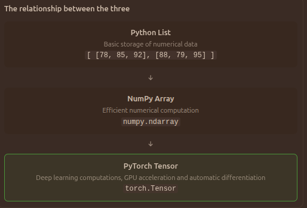
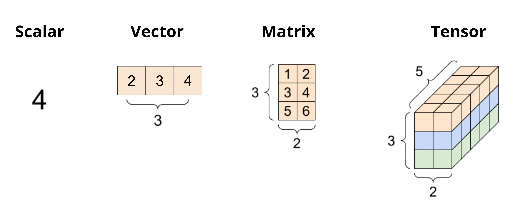

### Day 1:
**PyTorch Tensor**



- Objectives:
    -
    - **What numerical arrays are and why deep learning needs them.**

         *Numerical arrays are lke organized grid of numbers like single row, spreadsheet with value containig same data types.*

        *Deep Learning needs them as computer understand number rather than raw images, text or audio or any other visuals; another one is for easier and huge number of mathematical calucaltio and GPUs use this huge grid of number and crunch them for faster AI training use.*


    - **Relationship between python lists, NumPy arrays and PyTorch tensors.**

        *Python list can take in any data type but slow downs for the purpose of math*
        
        *Where NumPy Array takes in same type of data and packed neatly into memory and it fast on CPU making it fast and standared tool for data science.*

        *PyTorch Tensors same as NumPy array with extra power for GPU accessibility and can store  the method use for math and learn from it's past mistakes.*

        *Hints: NumPy and PyTorch store number as a single, unbroken block of raw bytes in RAM so we won't need to copy the data when we convert from NumPy to PyTorch.*

        


    - **Read and interpret tensor shapes.**

    - **First PyTorch tensor from a NUmPy array.**

    - **Basic Operation on tensor.**

---


    - **Understand Scalars, Vectors, Matrices and multidimensional tensors.**

***Dimensions and Shapes***

**Scalar**: Single numerical Values.
```
x=23
```
A scalar has dimensions

**Vector**: Collection of Numbers.
```
v = [10,20,30,40]
```
A Vector has one dimensions.

**Matrix**: Collection of rows and collumns.

```
m = [
    [1,2,3],
    [2,3,4]
]
```

A Matrix has two dimensions.

**Higher dimensional tensor**: Tensor with more than two dimensions.

```
(batch,channels,height,width)
```


---

